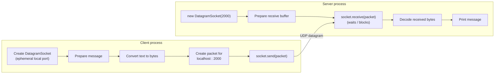
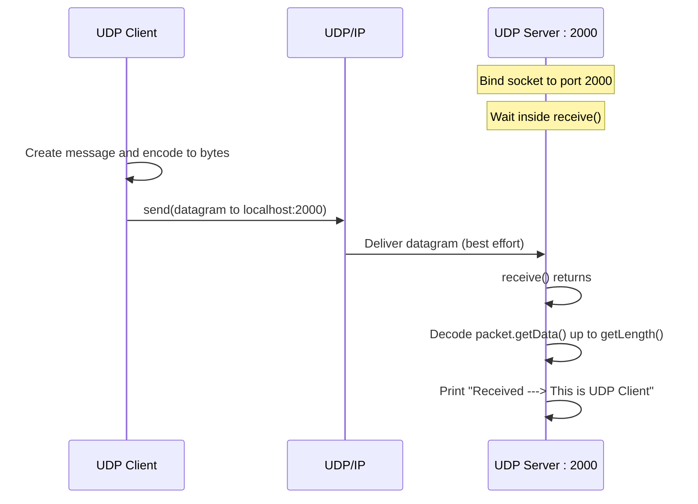
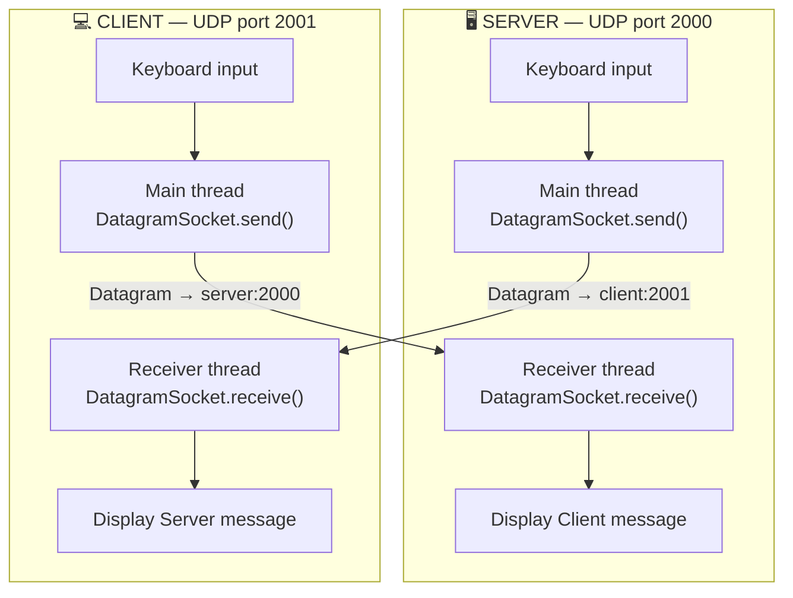
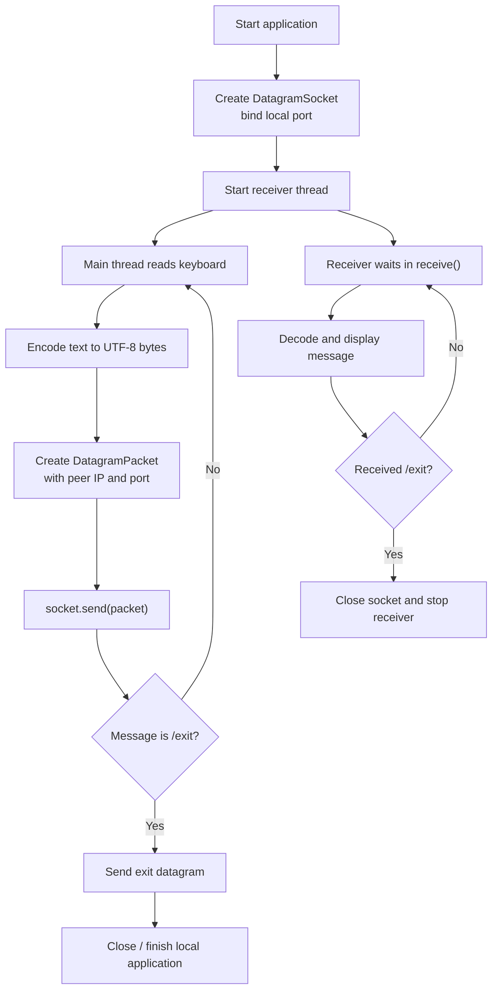

# 🌐 NetworkingUDP — Java UDP Socket Programming

> **Computer Networks Laboratory | Java | UDP (User Datagram Protocol)**  
> A visual, beginner-friendly guide to two UDP socket experiments: a simple client–server datagram exchange and a bidirectional terminal chat.

[](https://www.oracle.com/java/)
[](https://en.wikipedia.org/wiki/User_Datagram_Protocol)
[](#)

---

## 🧭 What you will build

| Experiment | What happens | Source code |
|---|---|---|
| **8.1 — Simple UDP** | Client sends one message; server receives and prints it | [Client](Java-UDP-Socket-Programming/Experiment-8.1-Simple-UDP/UDPClient.java) · [Server](Java-UDP-Socket-Programming/Experiment-8.1-Simple-UDP/UDPServer.java) |
| **8.2 — Bidirectional UDP Chat** | Client and server can send and receive messages simultaneously | [Client](Java-UDP-Socket-Programming/Experiment-8.2-Bidirectional-UDP-Chat/UDPClient.java) · [Server](Java-UDP-Socket-Programming/Experiment-8.2-Bidirectional-UDP-Chat/UDPServer.java) |

## 1. First understand UDP

UDP is a **connectionless transport-layer protocol**. An application can send a datagram without first establishing a TCP-style connection.

- No connection setup or teardown handshake is performed by UDP.
- Each datagram is independent.
- UDP does not guarantee delivery, ordering, or retransmission.
- It has a small, fixed **8-byte UDP header** (before the application payload).
- The application gets low-overhead message delivery and is responsible for any reliability it needs.

### TCP vs UDP — the big picture

| TCP | UDP |
|---|---|
| Connection-oriented | Connectionless |
| Reliable, ordered byte stream | Best-effort datagrams |
| Acknowledgements and retransmission | No built-in delivery acknowledgement or retransmission |
| More protocol overhead | Smaller protocol overhead |
| Example: file transfer | Example: DNS queries, real-time media, games |

### What is inside a UDP datagram?

The UDP header is 8 bytes: four fields, each 16 bits wide.

```text
  0                 15 16                31
 +--------------------+--------------------+
 |     Source Port    |  Destination Port  |
 +--------------------+--------------------+
 |       Length       |      Checksum      |
 +--------------------+--------------------+
 |                                           
 |             Application Data              |
 |                                           
 +-------------------------------------------+

       UDP header = 8 bytes
```

- **Source port:** identifies the sending application endpoint.
- **Destination port:** identifies the receiving application endpoint.
- **Length:** total UDP header + payload length.
- **Checksum:** helps detect corruption (mandatory in IPv6; optional in IPv4).

An IP address identifies the host; a port identifies the application endpoint on that host. Together they identify where a datagram should be delivered.

## 2. How Java represents UDP

Java provides two central classes in `java.net`:

| Java class / method | Purpose |
|---|---|
| `DatagramSocket` | Opens/binds a local UDP endpoint and sends/receives datagrams |
| `DatagramPacket` | Holds the bytes and, when sending, the destination IP and port |
| `InetAddress` | Represents/resolves an IP address such as `localhost` |
| `send(packet)` | Sends one datagram |
| `receive(packet)` | Waits for an incoming datagram; this call blocks until one arrives |
| `getData()` | Returns the packet's backing byte array |
| `getLength()` | Returns the number of valid received bytes |

### The journey of a message

```mermaid
flowchart LR
    A["Application message<br/>String"] --> B["UTF-8 encode<br/>String → byte[]"]
    B --> C["DatagramPacket<br/>bytes + destination"]
    C --> D["DatagramSocket.send()"]
    D --> E["UDP / IP network"]
    E --> F["Receiver DatagramSocket"]
    F --> G["DatagramSocket.receive()"]
    G --> H["Read packet bytes<br/>using getLength()"]
    H --> I["UTF-8 decode<br/>byte[] → String"]
    I --> J["Application receives message"]
```



**Why convert a String to bytes?** A network datagram carries bytes, not a Java `String`. The sender encodes text (UTF-8 here); the receiver decodes those bytes using the same character encoding.

---

# 🧪 Experiment 8.1 — Simple UDP Client–Server

## 3. Architecture

The client sends the text **`This is UDP Client`** to the server at `localhost:2000`. The server binds to UDP port `2000`, waits for one datagram, and prints the received text.



## 4. Message sequence



## 5. Understand the program step by step

### Server side

1. `new DatagramSocket(2000)` binds the server to UDP port 2000.
2. A byte array is created as a receive buffer.
3. A `DatagramPacket` wraps that buffer and is passed to `receive()`.
4. **Important:** `receive()` is blocking. The server pauses there until a datagram arrives.
5. The received text is decoded using the packet's actual offset and length, then printed.

### Client side

1. `new DatagramSocket()` creates a client socket and lets the operating system choose an available local port.
2. The message is encoded as UTF-8 bytes.
3. `InetAddress.getByName("localhost")` resolves the loopback host.
4. A packet is created with the bytes, destination address, and destination port 2000.
5. `send()` transmits the datagram. The client then exits.

### Expected output

Server terminal:

```text
UDP server waiting on port 2000...
Received ---> This is UDP Client
```

Client terminal:

```text
Message sent from client
```

---

# 💬 Experiment 8.2 — Bidirectional UDP Chat

## 6. Why do we need threads?

A simple program that calls `receive()` and then `send()` in one loop can get stuck waiting for a message. While it is blocked in `receive()`, the user cannot type and send a message.

**Solution:** each side uses two concurrent activities:

- **Main thread:** reads keyboard input and sends datagrams.
- **Receiver thread:** continuously waits for datagrams and displays incoming messages.

This allows both peers to type and receive messages independently.

## 7. Chat architecture and ports

| Endpoint | Local port | Sends to |
|---|---:|---|
| Server | 2000 | Client port 2001 |
| Client | 2001 | Server port 2000 |



## 8. Bidirectional message sequence

```mermaid
sequenceDiagram
    participant S as Server : 2000
    participant C as Client : 2001
    Note over S,C: Both sockets are bound; each receiver thread is running
    C->>S: "Hello Server"
    S->>S: Receiver thread displays message
    S->>C: "Hello Client"
    C->>C: Receiver thread displays message
    C->>S: "How are you?"
    S->>S: Receiver thread displays message
    S->>C: "I am fine!"
    C->>C: Receiver thread displays message
    Note over S,C: Either side can initiate the next message
```

## 9. What happens inside each chat application?



### Why use `packet.getLength()`?

The receive buffer may be larger than the actual message. For example, the buffer can hold 1024 bytes while the incoming message is only 12 bytes. Decode only the valid portion:

```java
String message = new String(
    packet.getData(),
    packet.getOffset(),
    packet.getLength(),
    StandardCharsets.UTF_8
);
```

This prevents unused bytes in the buffer from being treated as part of the message.

### How does `/exit` work here?

Typing `/exit` sends that text as a normal UDP datagram. When the peer's receiver thread gets it, it closes its socket. This is an application-level convention implemented by this example — **UDP itself has no chat disconnect handshake**.

---

## 10. Run the experiments

### Requirements

- JDK 8 or later
- Two terminal windows
- Run both programs on the same computer for the supplied `localhost` configuration

Check Java:

```bash
java -version
javac -version
```

### Experiment 8.1 — Compile and run

From the repository root:

```bash
javac Java-UDP-Socket-Programming/Experiment-8.1-Simple-UDP/UDPServer.java
javac Java-UDP-Socket-Programming/Experiment-8.1-Simple-UDP/UDPClient.java
```

Terminal 1 — start server first:

```bash
java -cp Java-UDP-Socket-Programming/Experiment-8.1-Simple-UDP UDPServer
```

Terminal 2:

```bash
java -cp Java-UDP-Socket-Programming/Experiment-8.1-Simple-UDP UDPClient
```

### Experiment 8.2 — Compile and run

```bash
javac Java-UDP-Socket-Programming/Experiment-8.2-Bidirectional-UDP-Chat/UDPServer.java
javac Java-UDP-Socket-Programming/Experiment-8.2-Bidirectional-UDP-Chat/UDPClient.java
```

Terminal 1:

```bash
java -cp Java-UDP-Socket-Programming/Experiment-8.2-Bidirectional-UDP-Chat UDPServer
```

Terminal 2:

```bash
java -cp Java-UDP-Socket-Programming/Experiment-8.2-Bidirectional-UDP-Chat UDPClient
```

Type a message in either terminal. Type `/exit` to send the exit command.

## 11. Common problems

| Problem | What to check |
|---|---|
| `Address already in use` | Another process is using UDP port 2000 or 2001; stop it or choose unused ports consistently |
| Client message is not displayed | Start the server first; verify destination IP and port |
| Chat can send but not receive | Check that both receiver threads are running and each peer targets the other's local port |
| `ClassNotFoundException` | Run the command from the repository root and check the `-cp` directory |
| Works locally but not across computers | Replace `localhost` with the server's reachable LAN IP and allow the UDP ports through the firewall |

## 12. Simple UDP vs Bidirectional UDP Chat

| Feature | Experiment 8.1 | Experiment 8.2 |
|---|---|---|
| Communication | One-way demo | Two-way chat |
| Server port | 2000 | 2000 |
| Client port | OS-assigned | 2001 |
| Receive behavior | One receive operation | Continuous receive thread |
| Sending | Client sends once | Both peers send repeatedly |
| Concurrency | Not required | Separate sender/input and receiver activities |

## 13. Important limitations

These are teaching examples, not production messaging software. UDP may lose, duplicate, or reorder datagrams. The chat does not implement acknowledgements, retransmission, message ordering, authentication, encryption, or robust peer discovery. A real application would need to design those features if required.

---

## 📁 Project structure

```text
NetworkingUDP/
├── README.md
└── Java-UDP-Socket-Programming/
    ├── README.md
    ├── .gitignore
    ├── Experiment-8.1-Simple-UDP/
    │   ├── UDPClient.java
    │   └── UDPServer.java
    └── Experiment-8.2-Bidirectional-UDP-Chat/
        ├── UDPClient.java
        └── UDPServer.java
```

## 🎓 Key takeaways

1. A **socket** is the application's communication endpoint; a UDP socket is associated with a local port.
2. A **datagram packet** carries bytes and destination addressing information.
3. The receiver must decode exactly the bytes received, not the entire buffer.
4. `receive()` blocks, so a separate receiver thread makes interactive two-way chat possible.
5. UDP is lightweight and connectionless, but delivery is best-effort.

---

**Made for Computer Networks Lab practice.**  
If you are studying this for a viva, focus on: *connectionless communication, ports, DatagramSocket, DatagramPacket, blocking receive, byte conversion, threads, and UDP's lack of delivery guarantees.*
